<div align="center">

<!-- ══════════════════════════ HERO ══════════════════════════ -->


<br/><br/>

<a href="https://readme-typing-svg.demolab.com">
  
</a>

<br/><br/>

<a href="https://www.linkedin.com/in/fahad-sadiq-khan"></a>
&nbsp;
<a href="mailto:khan.fsadiq05@gmail.com"></a>
&nbsp;
<a href="https://hadio.com"></a>

</div>

<br/>

## 🧭 What I do

I'm Head of Development at **[Hadio](https://hadio.com)**, a Montréal vintage retailer and patch wholesaler in business since 1991. I run the company's whole technical side and plan the roadmap directly with the owner.

I joined as a contractor in June 2026 and was hired full time to lead development a month later, at 20 and partway through a CS & Finance degree.

Most of what I build sits close to revenue: finding wholesale leads, reaching them, and turning them into orders. I work AI-first with Claude Code and ship to production most weeks.

<table>
<tr>
<td width="64%" valign="top">

### 🔨 What I've shipped at Hadio

<sub>Designed, built and run by me. Company code, so the source is private. Happy to walk through any of it.</sub>

- **Lead engine.** An 8-stage Python pipeline that pulls local retailers from OpenStreetMap and Overture data, crawls their websites, and scores each one with an LLM judge on the Claude API. Runs as a background worker on Render, with a map-based queue for reviewing leads.
- **Outbound CRM.** Turns approved leads into personalized bilingual (EN/FR) direct-mail letters with a QR code to the wholesale store, and tracks each lead from sent to converted.
- **[hadio.com](https://hadio.com).** Replaced the Shopify store with a bilingual React and Express site and a B2B wholesale storefront: tiered server-side pricing, design uploads, automated PDF order dispatch, and consent-gated GA4 and PostHog analytics.
- **Computer-vision checkout.** A YOLO detector plus a DINOv2 embedding matcher that identifies and prices 624 patch designs at the register, with 98.8% matching accuracy.
- **Operations dashboard.** React, TypeScript, Fastify and PostgreSQL for sales, purchasing and wholesale. Cut the slowest page from 32s to 1.7s.
- **[apply.hadio.com](https://apply.hadio.com).** A hiring portal with access-code gating, validated uploads and form-API sync.

</td>
<td width="36%" valign="top">

### ⚡ At a glance

```text
💼  Head of Development @ Hadio
🛠️  Python · TypeScript · SQL · Go
🤖  LLM pipelines · CV · automation
⚙️  Claude Code, every day
🎓  CS & Finance @ UofT (paused)
📍  Montréal, QC
```

</td>
</tr>
</table>

### 🧠 How I work

- **Own the roadmap.** I set priorities with the owner and work them top to bottom, starting with whatever is costing the business most.
- **Plan before code.** Every feature starts as an ordered prompt book: scope, model and checks for each step, run in Claude Code.
- **Custom tooling.** My own Claude Code skills and verifier subagents keep large changes reviewable, and nothing merges until tests and the typecheck pass.
- **Small and shipped.** I'd rather put a working version in front of users this week than a bigger one next month.

<br/>

<div align="center">

### 🧰 Arsenal


<br/>


</div>

<br/>

## 📂 Projects

### 👁️ ISTINA &nbsp;<sub>2025 to 2026</sub>

An LLM platform I founded that scored geopolitical news for bias and framing sentence by sentence, and compared how different outlets covered the same event. It launched with Stripe subscriptions. An n8n pipeline ranked articles, ran the analysis and claim checks, and generated TikTok carousels, and a set of Claude skills drafted posts for X, LinkedIn, Substack and Reddit.

I paused it in 2026. The product worked, but I couldn't solve distribution in a niche the big platforms restrict, and that lesson is a big part of why I care about go-to-market work.

🔗 **[istina.live](https://istina.live)** &nbsp;·&nbsp; 🔒 *Source private*

| Layer | Stack |
|---|---|
| Backend | `Python` · `FastAPI` · `JWT auth` · Docker on `Fly.io` |
| Frontend | `React` · `TypeScript` · `Vite` · `Tailwind` on `Vercel` |
| Data | `Supabase` · `PostgreSQL` |
| Engine | Sentence-level LLM bias scoring, framing detection, multi-stage claim verification |
| Pipeline | `n8n` with `Tavily` search: ranker → analyzer → claim verifier → carousel generator |

<sub>Started as a Rust CLI prototype that ingested RSS feeds and compared narratives across sources.</sub>

### 🧪 Ragebait-Skill &nbsp;<sub>pre-release</sub>

A Claude Code skill that writes modern short-form ragebait replies, built from a research pass that turned 41 creator posts into an 89-method library. It has a one-time setup and three intensity modes, and it's in final testing before the repo goes public. The launch post passed 15K impressions on LinkedIn.

<!-- Once the repo is public: link the heading to github.com/mufferio/Ragebait-Skill and drop "pre-release" -->

<br/>

### 🗂️ Public repos

<table>
<tr>
<td width="50%" valign="top">

#### ☕ [esp32-espresso-mod](https://github.com/mufferio/esp32-espresso-mod)


**"Frank"**, a PID temperature controller for my espresso machine that holds ±0.5 °C at target. ESP32, thermocouple and SSR, with a self-hosted web UI at `frank.local`. *Featured on r/arduino.*

</td>
<td width="50%" valign="top">

#### 🔧 [concave-tech](https://github.com/mufferio/concave-tech)


Layered REST API serving user data from PostgreSQL via Gin, with controller, service, repository and DTO layers, and Docker Compose for local Postgres and pgAdmin.

</td>
</tr>
<tr>
<td width="50%" valign="top">

#### 👾 [SOTD Engine](https://github.com/mufferio/SOTD-riscv-assembly-engine)


A survival-horror game written entirely in RISC-V assembly, with infinite undo (a 512-snapshot ring buffer), Chebyshev-distance monster AI and a multiplayer leaderboard.

</td>
<td width="50%" valign="top">

#### 🗜️ [file-compression-engine](https://github.com/mufferio/file-compression-engine)


Quadtree-based lossy image compressor that partitions images by regional variance into a custom `.qdt` format, for about 5× smaller files at moderate loss.

</td>
</tr>
<tr>
<td width="50%" valign="top">

#### ✈️ [frequent-flyer-data-parser](https://github.com/mufferio/frequent-flyer-data-parser)


Airline sim that loads tens of thousands of CSV rows into a typed domain model with frequent-flyer tier logic, plus an interactive map with real-time filtering.

</td>
<td width="50%" valign="top">

#### ♟️ More in Java

[othello-java-engine](https://github.com/mufferio/othello-java-engine): Othello with greedy and random AI, JUnit-tested.
[paint3d-mario-edition](https://github.com/mufferio/paint3d-mario-edition): JavaFX paint app built on MVC, Observer and Strategy.
[paint3d-visitor-fsm-parser](https://github.com/mufferio/paint3d-visitor-fsm-parser): custom save format with an FSM-style parser.

</td>
</tr>
</table>

<br/>

## 💼 Experience

**Head of Development** · *Hadio Friperie Vintage* &nbsp;|&nbsp; `06/2026 – Present`
Lead development for the business and plan the roadmap directly with the owner. Joined as a contractor and was hired full time in 07/2026 to run the department. Own the architecture and delivery of every system Hadio runs on: the website and B2B wholesale store, the lead engine and outbound CRM, the computer-vision register, internal dashboards, the employee and hiring portals, and the production Postgres database behind them.

**Software Developer** · *Concave Tech* &nbsp;|&nbsp; `05/2025 – 08/2025`
Built a production user-service backend in **Go** with REST APIs for secure ingestion and validation, salted and hashed credential storage, and indexed **PostgreSQL** schemas. Containerized with **Docker** and cut auth-related failures by about **40%**.

**Software Engineer** · *Elections Ontario* &nbsp;|&nbsp; `01/2025 – 02/2025`
Ran on-site technical operations during the Ontario provincial election and resolved **95%+ of technical issues on first response**, keeping the voting infrastructure fully operational.

**Software Engineer** · *Hawks Management & Solutions* &nbsp;|&nbsp; `06/2023 – 08/2023`
Built a **Python** task delegation and tracking system with a small team; automated assignment and live progress tracking raised weekly task throughput **10×**.

<br/>

## 🛤️ The journey


<details>
<summary><sub>Prefer plain text? Read it here.</sub></summary>

<br/>

**`2023`** First dev job, at Hawks: a Python task system that raised a team's weekly throughput 10×.

**`2024`** Started Computer Science & Finance at the University of Toronto.

**`2025`** Built production Go backends at Concave Tech, then founded ISTINA.

**`2026`** Moved from Toronto to Montréal with no network, worked outside tech while I built one, joined Hadio as a contractor, and was hired full time to run development.

</details>

<br/>

<div align="center">

<!-- ══════════════════════════ SNAKE ══════════════════════════ -->


<br/><br/>

🎓 **Honors BSc & BCom, Computer Science and Finance @ University of Toronto** &nbsp;·&nbsp; 2024 to present, studies paused

<sub>The fastest way to reach me is LinkedIn or email.</sub>

</div>
